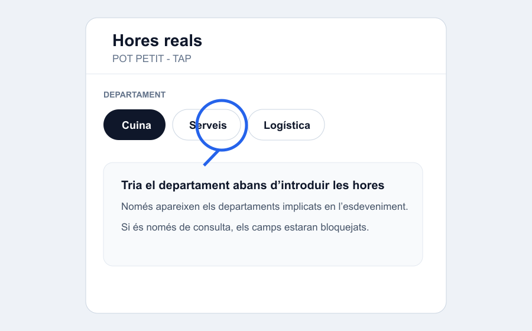
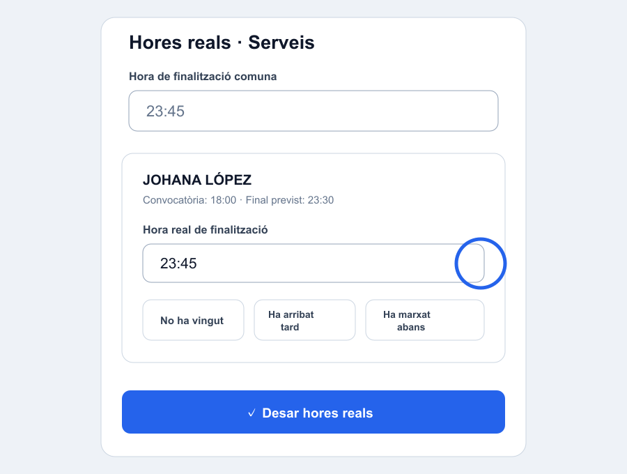
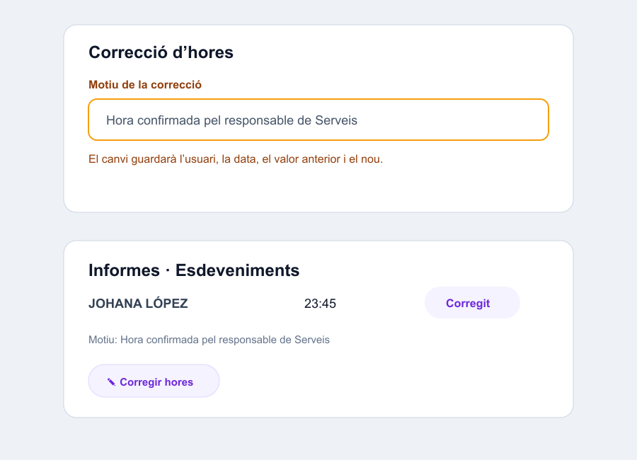

# Manual de tancament operatiu i correcció d’hores

Aquest manual explica com informar i corregir les hores reals del personal d’un esdeveniment. Està pensat per a responsables i comercials de Foodlovers amb accés al tancament operatiu.

> **En resum:** tria el departament, revisa el personal, informa les hores i prem **Desar hores reals**.

## 1. Obrir el tancament operatiu

1. Entra a **Esdeveniments**.
2. Obre l’esdeveniment que vols tancar.
3. Prem **Tancament operatiu**.
4. Entra a **Hores reals**.

## 2. Triar el departament

A la part superior veuràs només els departaments implicats en l’esdeveniment, per exemple **Cuina**, **Serveis** i **Logística**.

- Prem el departament que vols revisar.
- Si apareix **Aquest departament és només de consulta**, podràs veure les dades però no modificar-les.
- Per editar altres departaments cal el permís **Modificar hores de tots els departaments**.

## 3. Informar les hores reals

Pots introduir una hora per persona o utilitzar **Hora de finalització comuna** per aplicar la mateixa hora a totes les persones presents.

Per cada persona també pots indicar:

- **No ha vingut:** marca una absència.
- **Ha arribat tard:** demana l’hora real d’arribada.
- **Ha marxat abans:** registra una sortida anticipada.
- **Observacions:** explica breument la incidència.

Quan hagis acabat, prem **Desar hores reals**.

## 4. Corregir unes hores ja desades

Si canvies una hora que ja estava desada, apareixerà el camp obligatori **Motiu de la correcció**. Escriu una explicació curta i concreta, per exemple: *Hora confirmada pel responsable de Serveis*.

En desar, el sistema registra automàticament l’usuari, la data, el departament, el valor anterior, el valor nou i el motiu.

## 5. Consultar el resultat a Informes

Entra a **Informes → Esdeveniments**. Les hores corregides apareixen amb l’estat **Corregit** i mostren el motiu.

Si tens permís, pots prémer **Corregir hores** des del mateix informe. S’obrirà el mateix editor del tancament operatiu.

## Comprovació ràpida abans de sortir

- [ ] He seleccionat el departament correcte.
- [ ] He revisat totes les persones.
- [ ] He informat absències, retards o sortides anticipades.
- [ ] He premut **Desar hores reals**.
- [ ] Si era una correcció, he indicat el motiu.

> Si només veus un departament o els camps estan bloquejats, demana que et revisin els permisos de tancament operatiu i d’edició interdepartamental.
